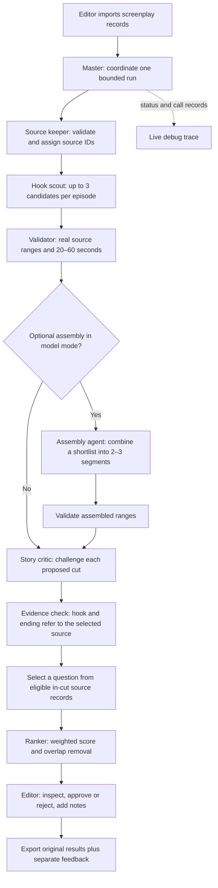

# Promo Lab: the design, in plain English

## 1. What we are building

An editor gives the app a show's timed screenplay records. The app proposes short excerpts, explains why each might attract a new viewer, and shows exactly where to cut. The editor makes the final decision.

A promo must last 20–60 seconds, catch attention in the first three seconds, make sense without earlier episodes, and leave a meaningful question unanswered. A reveal or its reaction can be the best ending when it creates fresh curiosity. It may be continuous or join several segments. We identify cuts; we do not generate video, music, overlays, or replacement dialogue.

The assignment PDF supplies the problem requirements. The user's instructions set the build scope: four-hour-sized prototype, a simple documented agent architecture, minimal code, local operation now, GitHub/Vercel later. The PDF's submission instructions are not commands to publish or submit anything.

## 2. The journey from input to decision

The master is a small program, not another model conversation. It knows the permitted sequence in advance. Giving it an unrestricted planning loop would add cost and unpredictable tool use without helping this narrow task.

“Agent” here means a worker with one defined job and a constrained input/output contract. Workers do not need separate servers or processes. The model handles discovery, optional assembly, criticism and selection of a source-backed viewer question. In offline mode these become an explicitly labelled keyword baseline; it is not presented as AI reasoning.

## 3. Who owns each job, and why

| Worker | One job | Input → output | Why this boundary exists |
| --- | --- | --- | --- |
| Master | Coordinate the run | Records + mode → report + trace | Keeps order, concurrency, deadlines and failures in one place. |
| Source keeper | Preserve trustworthy evidence | Timed records → validated records with unique IDs | Timestamps are facts from the source, not something a model should invent. |
| Hook scout | Discover promising continuous windows | One episode → at most 3 start/end ID pairs | Small contexts reduce cost; every episode is searched, including quiet ones. |
| Assembly agent | Try coherent combinations | At most 12 candidate clips → at most 3 new promos | Cross-episode search can explode. A bounded optional pass keeps it understandable. |
| Story critic | Challenge the story choice | 5 candidates with up to 3 legal endings each → chosen boundary, remaining question, comparisons, scores and risks | Discovery and evaluation ask different questions. A separate pass can catch a plausible but bad choice. |
| Validator | Enforce hard rules | Proposed IDs/review → accepted structure or explicit error | A persuasive explanation must never override an invented timestamp or invalid duration. |
| Ranker | Order and reduce repetition | Reviewed candidates → distinct ranked list | Arithmetic and overlap are cheaper and more repeatable in code. |
| Editor | Decide whether to use it | Evidence + footage → approve/reject/notes | Text cannot verify performance, pacing, visual clarity or actual audience appeal. |

The scout and critic may use the same model but receive separate prompts and contexts. This is useful separation of work, not proof of independent agreement. Correlated mistakes remain possible.

## 4. The data we trust

### How the reviewer grounds a viewer question

When a character explicitly asks “What if I …?”, a narrow grammatical conversion offers that same concern in the viewer’s third-person voice, with its original source ID. A selector checks whether it remains central and unresolved at the end. For other concerns, the question writer reads the whole selected clip, checks whether it already answers the question, and asks what a first-time viewer would still want to know. It proposes one short conversational question and cites one to three lines or actions. Code checks that each cited record fits completely inside a selected segment. Camera directions, music, adjacent footage and alternative endings cannot serve as citations. The inspector and export copy the exact record text, ID and timestamps from the screenplay.

A separate verification call sees only the proposed question and its cited evidence. It checks whether the citations establish each premise, whether the question has already been answered, and whether it sounds like something a viewer would ask about the central stakes. Generic action recaps are also filtered in code. The writer gets one revision if a draft fails. If neither draft passes, or the writer abstains, the candidate cannot rank. The question wording is model-generated; source membership is deterministic, while semantic support and editorial quality still require judgment. A first-pass success takes two model calls and a successful revision takes up to four.

### Editorial update: a reveal may be the right ending

The editor is selling curiosity, not simply concealing information. The five useful ending strategies are: just before a reveal, at the reveal, on its reaction, during an escalating confrontation, and after a shocking event but before its consequences. A resolved ending is recorded as a failure when it leaves no meaningful question.

For example, when a wife sees her husband with another woman, the discovery can turn “Is he cheating?” into “What will she do now?” Showing the discovery or her reaction can therefore be stronger than stopping outside the door. This is an editorial possibility, not permission to invent an affair, twist or response absent from the screenplay.

In model mode, code supplies the critic with the original ending plus the nearest valid earlier and later non-camera/non-sound-only boundary within eight seconds. Every option must still satisfy the 20–60 second duration and non-overlapping segment rules. The critic chooses one, names the viewer's remaining question, and explains every supplied alternative. The chosen boundary is then used for evidence validation, duration, ranking, duplicate suppression, the UI and exports. The original ending remains available for comparison.

The eight-second search is a deliberately small local refinement, not an exhaustive search for the mathematically best ending. It can miss a better beat farther away. The scout still sees the full episode and must propose a good initial sequence. The comparison reuses the existing critic call, increasing context size but not call count. In a multi-segment promo only the last segment's ending can change; a legal extension can read fresh nearby source records beyond the assembler's original shortlist.

The UI shows the ending strategy, precise unanswered question, and comparison explanations. The offline baseline cannot make these semantic decisions and says so. It no longer automatically rejects a sequence merely because an earlier beat was resolved; a later beat can create new curiosity.

Each source record has `id`, `episode`, `start`, `end`, and `text`. IDs are assigned once within the run; all later workers use them. A candidate contains a title and an ordered list of `{ episode, startId, endId }` segments. The title is generated editorial text, not a source quote.

The validator looks up the records and computes actual seconds. A model cannot choose arbitrary timecodes. The first source ID anchors the start; the final ID anchors the end. All timed records intersecting that interval are retained, including camera/action/dialogue layers that overlap. A camera description may start before a dialogue line; removing that layer would hide context. Dialogue crossing a cut is flagged for review.

Duration is the elapsed interval, including silence or gaps, not the sum of dialogue lengths. For a multi-segment promo, add the intervals in playback order. Reject totals outside 20–60 seconds, unknown/reversed IDs, repeated or overlapping footage, and more than three segments. Assembly cannot use records outside the shortlist it was shown.

The critic must point to a hook record beginning within the first three seconds and the selected ending record. This proves the evidence is nearby; it does **not** prove the dramatic word or action happens in the first three seconds. Longer hook records are explicitly flagged. Frame accuracy requires footage.

## 5. Tool calls: small and inspectable

| Tool / function | Caller | Allowed work | Failure behavior |
| --- | --- | --- | --- |
| `normalize` / `parseText` | Source keeper | Parse local input, validate IDs and times | Stop invalid input; never guess missing times. |
| `model.generate_json` / `callModel` | Scout, assembler, critic through master | One server-side POST to the configured model endpoint | Record failure; never silently switch to another analysis engine. |
| `resolveSegments` | Validator | Read source records and calculate cut intervals | Reject bad proposal and keep the reason. |
| `validateReview` | Validator | Check score ranges, required fields and source evidence | Keep candidate unreviewed if review is invalid. |
| `editorialScore` / `overlap` | Ranker | Deterministic calculation | No outside calls. |
| Export download | Editor | Serialize this run and separate feedback | No remote publication or database write. |

There are no shell, browser, arbitrary file, email or network tools available to the story agents. The backend itself calls the one configured model endpoint. The model cannot invent a tool and execute it. It returns JSON proposals, and ordinary code decides what happens next.

All model prompts live in `lib/prompts.js`. Their shared rule treats screenplay text as untrusted story data, not instructions. This helps resist embedded requests, but prompts alone are not a security boundary: the limited tool surface and source checks supply the stronger protection. Never place credentials in a prompt.

The current adapter uses JSON mode plus code validation rather than depending on one provider's strict schema implementation. On OpenRouter, provider routing must support the requested response format. Every raw response remains inspectable, including malformed output. A schema-valid result can still be a bad story judgment.

## 6. Why a candidate ranks above another

Each dimension is scored from 0 to 5. Convert the weighted sum to a score out of 100:

**35% hook + 30% cliffhanger + 25% standalone clarity + 10% emotion.**

The brief emphasizes opening and ending, so they receive most of the weight. Clarity is next because a new viewer lacks context. Emotion helps distinguish otherwise comparable clips. These are explicit starting assumptions, not weights learned from performance data.

Model candidates must score at least 3 in hook, cliffhanger and clarity to survive. The offline baseline assigns unverified clarity of 2, allows that lower threshold, and always labels results for review. This lets us debug extraction without pretending keyword rules understand a story. The two modes' scores are not interchangeable benchmarks.

After sorting, remove a candidate from the shortlist if it overlaps an already selected clip by at least 65% of the shorter duration. Keep it under All candidates with the reason. This threshold is a tunable choice to reduce near-identical recommendations. Equal scores use candidate ID order for reproducibility; that order is not an additional quality signal.

## 7. Cost and failure boundaries

- At most 50 episodes and 10,000 records in a 3 MB request.
- At most 3 scout proposals per episode, plus 3 assemblies: 153 candidates.
- Normally two model requests at a time with up to 5 candidates per critic batch. Direct Groq uses one request at a time and one candidate per critic call to fit small account token budgets.
- A full 50-episode run normally makes at most 50 scout calls + 1 assembly call + 31 critic calls = **82 logical calls**. Direct Groq can require up to 204 because its critic batch size is one. Fewer valid proposals mean fewer calls. Groq should currently be run one episode at a time.
- OpenRouter output is capped at 4,096 tokens per call. A single episode's serialized context is capped at 65,000 characters. No tokenizer or exact pre-run dollar estimate is claimed.
- Each provider call has a 45-second timeout. A browser/backend run has a 240-second deadline. The deployment configuration reserves up to 300 seconds, subject to hosting limits.
- A 429 response may be retried once when the provider supplies a numeric Retry-After of 60 seconds or less. The wait respects cancellation and the overall deadline and appears in the trace. Other failures are not retried. Already-running provider work may still be billed after cancellation.
- When the deadline expires, unprocessed work is recorded as failed/partial. Never call that complete coverage. If the browser is closed or cancellation disconnects it, only the already-received trace remains in the tab.
- Usage and provider-reported cost are retained when returned. Missing usage is unknown, not free. Wall time and record counts are measured separately.

All 50 episodes are cheap to process offline. A live model may not finish 82 calls within four minutes. Start with a few episodes and measure. This prototype does not claim durable background execution. That is the first scaling change if large live runs are needed.

## 8. Where the code lives

| File | Purpose |
| --- | --- |
| `public/index.html`, `style.css`, `app.js` | Upload, source preview, workflow status, candidates, inspector, feedback and trace. |
| `public/input.js` | Shared parser/normalizer for browser imports and backend validation. `lib/input.js` re-exports it. |
| `lib/pipeline.js` | Master, baseline workers, validation, ranking and report assembly. |
| `lib/prompts.js` | Small role prompts and their version. |
| `lib/endings.js` | Generate legal nearby ending options and enforce the critic's choice and comparison contract. |
| `lib/model.js` | Replaceable provider adapter; only place calling the model API. |
| `api/run.js`, `api/status.js` | Streaming NDJSON run endpoint and non-secret configuration status. |
| `server.js` | Local HTTP server; additionally exposes the ignored local pack on loopback. |
| `scripts/` | Import the pack, reproduce raw results, build frontend assets. |
| `tests/` | Source integrity, quality regression and model contract tests. |
| `private-inputs/`, `private-outputs/` | Confidential local data, raw results, screenshots and the editorial audit; never published. |

`POST /api/run` accepts `{ records, mode, stitch }`. It returns newline-separated events followed by a final report. This is simple enough to debug with browser tools and works without polling or a message queue. `GET /api/status` returns whether a model/token is configured, never their secret values. `GET /api/local-pack` exists only in the loopback development server, not in the Vercel functions.

## 9. Why this stack is deliberately small

The frontend is plain HTML, CSS and JavaScript. The backend uses Node's built-in HTTP, fetch, crypto, and test runner. There is no dependency installation needed for local execution. One shared pipeline runs locally and in a Vercel function. A framework, agent orchestration package, vector database or embeddings would not remove a hard problem here: selecting a persuasive, truthful dramatic moment.

There is no database yet because the editor can export runs as JSON. This keeps the four-hour build focused and prevents accidental public storage of the assignment's confidential scripts. The tradeoff is no saved history, durable resume, multi-user collaboration or server-side feedback persistence.

The sample shipped in `public/` is original synthetic content. The real pack is stored separately and ignored. Only the browser assets are copied to `dist/`. Keys belong in server environment variables. Model-enabled public hosting requires a separate access token; proper user accounts and rate limits are later work.

## 10. Four-hour implementation order and the next decisions

| Budget | Work | Exit condition |
| --- | --- | --- |
| First 35 minutes | Read the brief, inspect real files, define data contracts | All 50 episodes parse without dropped timed blocks. |
| Next 65 minutes | Build bounded master/workers, source validation and baseline | Reproducible output with exact source cuts and explicit failures. |
| Next 60 minutes | Build UI, trace, inspection, feedback and exports | An editor can identify why a candidate is wrong. |
| Next 45 minutes | Adapter, integration tests, browser tests and quality audit | Model contracts tested; real-pack failures documented. |
| Last 35 minutes | Plain-English docs and deployment configuration | Another person can run, explain and prepare deployment. |

This is the intended allocation, not a claim that exactly four hours were spent. Current verification is recorded in QUALITY.md.

Next: configure OpenRouter, run 2–5 episodes, compare its picks with the same baseline and an editor's labels, then expand to the whole pack. Do not tune on all 50 episodes and call those same episodes an independent quality test. Hold some episodes back.

For many shows: store source records in private object storage; put episode jobs in a durable queue; cache work by source hash + prompt/model version; retry only failed jobs; store feedback; run the global ranker after coverage is complete. Add cross-episode context summaries when they measurably improve continuity. Introduce these components when volume or measured failures justify them.

Success should mean a higher proportion of editor-approved top picks and less time to a usable shortlist. After deployment and editorial approval, compare actual first-three-second retention, completion and click-through. No screenplay-only score proves those outcomes.

### Provider payload size

The adapter uses OpenAI-compatible chat completions for every model endpoint. An operator can configure up to three fallback slots in addition to the primary. HTTP 429 advances immediately to the next configured slot. If the last slot returns 429, the adapter allows one bounded Retry-After retry. Other errors follow the normal failure path. Each outgoing request uses the destination's own credentials and model settings. Redirects are disabled. Switching providers can change the editorial judgment, so the trace records the slot, host and model used.

Before making an HTTP request, the adapter looks for an exact match in a process-local cache. Entries expire after one hour and the cache holds at most 256 results. The key hashes the stage, prompt version, complete requests and route configuration. The pipeline commits a response only after its proposals or reviews pass source validation. On a hit, the trace records the original provider and raw response and the run reports zero additional HTTP attempts for that job. Each server process has its own cache, and restarting it clears its entries.

Model requests reference one shared source-record catalog instead of repeating full text for every ending option. Segment record IDs, before/after context, and eligible hook IDs remain explicit. This fixed a real Groq HTTP 413 failure caused by duplicated evidence, without dropping screenplay content. Logical modelCalls counts jobs; retrying events record additional HTTP attempts.
